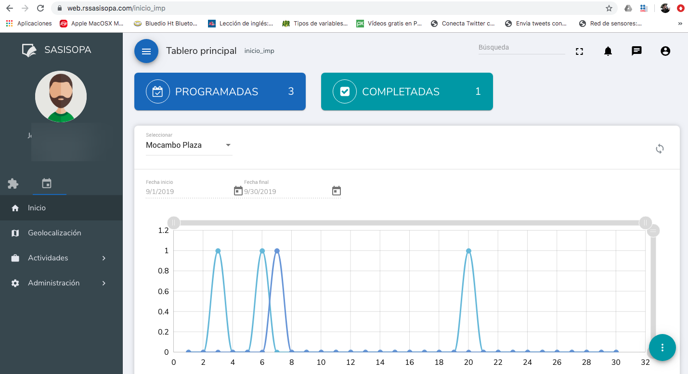
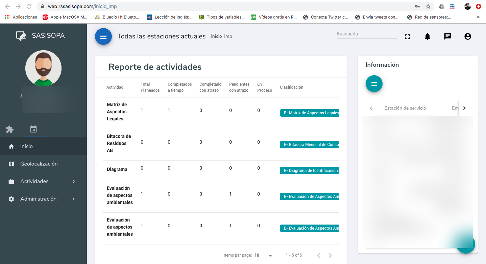
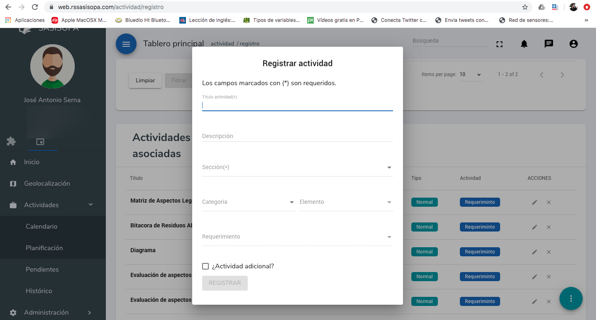
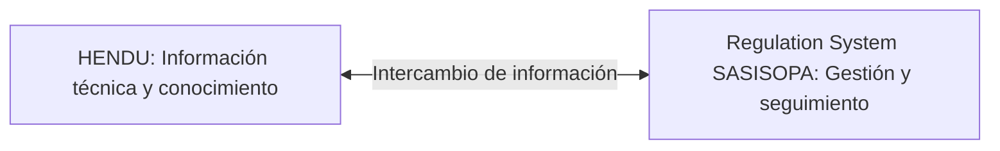

  

  
  
  

# Regulation System SASISOPA

**Plataforma de administración y seguimiento de SASISOPA para estaciones de servicio**  
**Caso de estudio profesional · Plenumsoft Energy & Sustainability**

Durante mi etapa como **Gerente Técnico**, **lideré el desarrollo de Regulation System SASISOPA**. Este producto empresarial se orientaba a apoyar la conformación, implementación y seguimiento del SASISOPA mediante una plataforma para organizar entregables, planificar actividades y monitorear avances.

**Regulation System SASISOPA era un producto independiente de HENDU.** Ambos sistemas podían **intercambiar información**, pero no debe interpretarse que SASISOPA fuera solamente un módulo interno de HENDU ni que compartieran necesariamente código o bases de datos.

> **Alcance:** este repositorio documenta mi liderazgo técnico y las funcionalidades presentadas en un folleto comercial histórico. No distribuye el software original, materiales internos ni datos de clientes. El producto utilizó ASP.NET MVC, C#/.NET, Entity Framework, PostgreSQL con PostGIS y Microsoft Azure, de acuerdo con la confirmación del responsable técnico del proyecto.

## 🎯 El problema que abordaba

La implementación y seguimiento de un sistema de administración de seguridad industrial y protección ambiental requiere coordinar actividades, evidencias, responsables y seguimiento de avances. El producto buscó apoyar estos procesos con una herramienta organizada y accesible a equipos operativos.

## 📸 Evidencia visual histórica

Las siguientes capturas documentan interfaces de **Regulation System SASISOPA** en septiembre de 2019. Se presentan como evidencia visual de funcionalidades de la plataforma, no como una demostración activa ni como confirmación de su disponibilidad actual. Los datos identificables se han anonimizado para su publicación.

### Tablero principal e indicadores

*Vista de seguimiento con indicadores de actividades programadas y completadas, selección de estación de servicio, rango de fechas y gráfica de actividad.*

### Reporte de actividades

*Consulta de actividades por estación, con cantidades planificadas, completadas, pendientes y en proceso, además de su clasificación.*

### Registro de actividades

*Formulario para capturar actividades con título, descripción, sección, categoría, elemento y requerimiento.*

> **Atribución:** capturas históricas de un producto desarrollado en el ámbito de Plenumsoft Energy & Sustainability. Se muestran exclusivamente como documentación de experiencia profesional; la titularidad del software y sus materiales permanece con sus respectivos propietarios.

## 🧩 Funcionalidades del producto

El folleto comercial describe estas capacidades:

| Área | Capacidad presentada |
| :--- | :--- |
| **Entregables** | Administración y consulta organizada de documentos y evidencias |
| **Actividades** | Configuración y planificación de tareas y requerimientos operativos |
| **Seguimiento** | Monitoreo de avances, bitácoras y cumplimiento de información requerida |
| **Estaciones** | Administración geográfica de estaciones de servicio |
| **Indicadores** | Monitoreo de KPI y seguimiento de actividades |
| **SASISOPA** | Apoyo a los procesos de conformación e implementación |

El folleto organiza la propuesta en un ciclo de **identificar, planear, monitorear y mejorar**, e incluye temas de riesgos y peligros, medidas de prevención y control, respuesta a emergencias y mejora continua.

## 🛠️ Stack tecnológico

Regulation System SASISOPA fue desarrollado con el mismo stack tecnológico utilizado en HENDU, según confirmación del responsable técnico de ambos productos.

| Capa o ámbito | Tecnología |
| :--- | :--- |
| Plataforma de aplicación | **ASP.NET MVC / C# / .NET** |
| Acceso y persistencia de datos | **Entity Framework** |
| Base de datos y capacidades geoespaciales | **PostgreSQL con PostGIS** |
| Infraestructura de despliegue | **Microsoft Azure** |

Compartir tecnologías **no implica** que ambos productos compartieran código fuente, una base de datos o la misma arquitectura interna.

## 🔗 Producto independiente e interoperabilidad

Como parte de la oferta tecnológica de Plenumsoft Energy & Sustainability, **Regulation System SASISOPA y HENDU podían compartir datos entre sí**.

*Esquema conceptual. No representa un protocolo, API, integración de bases de datos o arquitectura interna específica.*

## 👤 Mi responsabilidad

Participé como **líder del proyecto y Gerente Técnico**, dirigiendo el desarrollo tecnológico de la solución. Esta experiencia forma parte de mi trayectoria en liderazgo de productos empresariales orientados a procesos especializados de la industria energética.

## 📌 Evidencia y límites

La fuente comercial de dos páginas, denominada **Regulation System SASISOPA**, incluye funciones, visualizaciones de interfaz y diagramas operativos. Su carácter publicitario **no demuestra por sí mismo el estado de producción, adopción o comercialización** de cada capacidad.

- No se publican métricas de desempeño, ventas o usuarios no verificadas.
- El stack tecnológico se documenta por confirmación del responsable técnico, no por inferencia a partir de HENDU.
- La confirmación de Microsoft Azure como infraestructura no especifica servicios, topología ni configuración del despliegue.
- La documentación no describe mecanismos técnicos concretos de intercambio de datos.

Ver [contexto del producto, atribución y límites](docs/project-context.md).

## 🔒 Propiedad intelectual

Regulation System SASISOPA es un producto desarrollado en el ámbito de **Plenumsoft Energy & Sustainability**. Las marcas, el software y materiales originales pertenecen a sus respectivos titulares. Este repositorio es **únicamente un caso de estudio profesional** y no implica que el proyecto o sus servicios sigan activos actualmente.

---

<strong>Liderazgo técnico · Software empresarial · Procesos regulatorios · Interoperabilidad</strong>

<a href="https://github.com/isaiassolis">Isaías Solís</a> · Portafolio profesional
