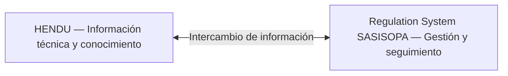

  

  
  
  

# Regulation System SASISOPA — Gestión y seguimiento para estaciones de servicio

**Dirección tecnológica del proyecto · Plenumsoft Energy & Sustainability**

Durante mi etapa como **Gerente Técnico en Plenumsoft Energy & Sustainability**, lideré el desarrollo de **Regulation System SASISOPA**, un producto empresarial orientado a organizar y dar seguimiento a actividades, entregables y procesos relacionados con el Sistema de Administración de Seguridad Industrial, Seguridad Operativa y Protección al Medio Ambiente (**SASISOPA**) en estaciones de servicio.

Trabajamos en una solución que facilitara la planificación de actividades, el registro de información y la consulta del avance de los trabajos desde una misma plataforma.

## El desafío

La implementación y el seguimiento de SASISOPA requieren coordinar actividades, responsables, documentos, fechas y tareas en distintas estaciones de servicio. Contar con esa información de forma organizada ayuda a identificar pendientes y consultar el estado de las actividades.

**Nuestro objetivo fue convertir ese seguimiento en un proceso más claro y accesible para los equipos de trabajo.**

## La solución

Regulation System SASISOPA reunía herramientas de administración y seguimiento para las operaciones de las estaciones de servicio.

| Área | Funcionalidad |
| :--- | :--- |
| **Actividades** | Registro, configuración y seguimiento de actividades y requerimientos. |
| **Reportes** | Consulta de actividades planificadas, completadas, pendientes y en proceso. |
| **Indicadores** | Tableros con datos de avance y seguimiento de actividades. |
| **Estaciones de servicio** | Organización de información por estación y consulta de su actividad. |
| **Entregables** | Organización de documentos e información asociada a los procesos de trabajo. |
| **Planificación** | Apoyo para estructurar tareas y dar seguimiento a su ejecución. |

La solución contemplaba además áreas relacionadas con identificación de riesgos y peligros, prevención y control, atención de emergencias y mejora continua.

## Capturas de Regulation System SASISOPA

### Tablero e indicadores

*Resumen de actividades, indicadores y filtros por estación y periodo.*

### Reporte de actividades

*Consulta del avance de actividades por estación de servicio.*

### Registro de actividades

*Registro de tareas con su descripción, categoría y requerimientos.*

## Tecnologías

Desarrollamos el producto con tecnologías de software empresarial y gestión de información geoespacial:

| Componente | Tecnología |
| :--- | :--- |
| Aplicación web | **ASP.NET MVC · C# · .NET** |
| Acceso a datos | **Entity Framework** |
| Base de datos | **PostgreSQL** |
| Capacidades geoespaciales | **PostGIS** |
| Infraestructura | **Microsoft Azure** |

## Relación con HENDU

**Regulation System SASISOPA fue un producto independiente de HENDU.** Aunque estaban orientados a necesidades diferentes, ambos podían intercambiar información.

- **HENDU** se enfocaba en la administración de información técnica, conocimiento y activos para Oil & Gas.
- **Regulation System SASISOPA** se enfocaba en la organización y seguimiento de procesos relacionados con SASISOPA en estaciones de servicio.

[Conocer HENDU](https://github.com/isaiassolis/hendu-enterprise-data-management).

## Mi participación

Como **Gerente Técnico y líder del proyecto**, dirigí el desarrollo tecnológico de Regulation System SASISOPA.

Mi trabajo consistió en coordinar la construcción de la solución y orientar su desarrollo hacia las necesidades de seguimiento y administración de procesos de las estaciones de servicio.

Este producto forma parte de mi experiencia en **liderazgo de proyectos de software empresarial, integración de soluciones y tecnología aplicada a procesos especializados de la industria energética**.

## Sobre el proyecto

Regulation System SASISOPA fue desarrollado en **Plenumsoft Energy & Sustainability**. Este repositorio presenta mi participación profesional y las principales funcionalidades del producto, sin incluir su código fuente ni datos de clientes.

[Más información sobre el proyecto](docs/project-context.md).

---

<strong>Gerencia técnica · Desarrollo de software empresarial · Gestión de procesos</strong>

<a href="https://github.com/isaiassolis">Volver a mi portafolio profesional</a>

